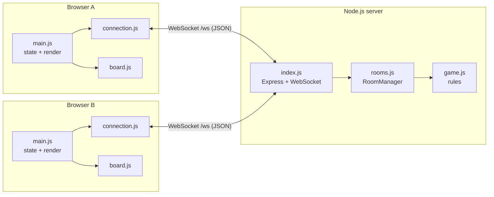
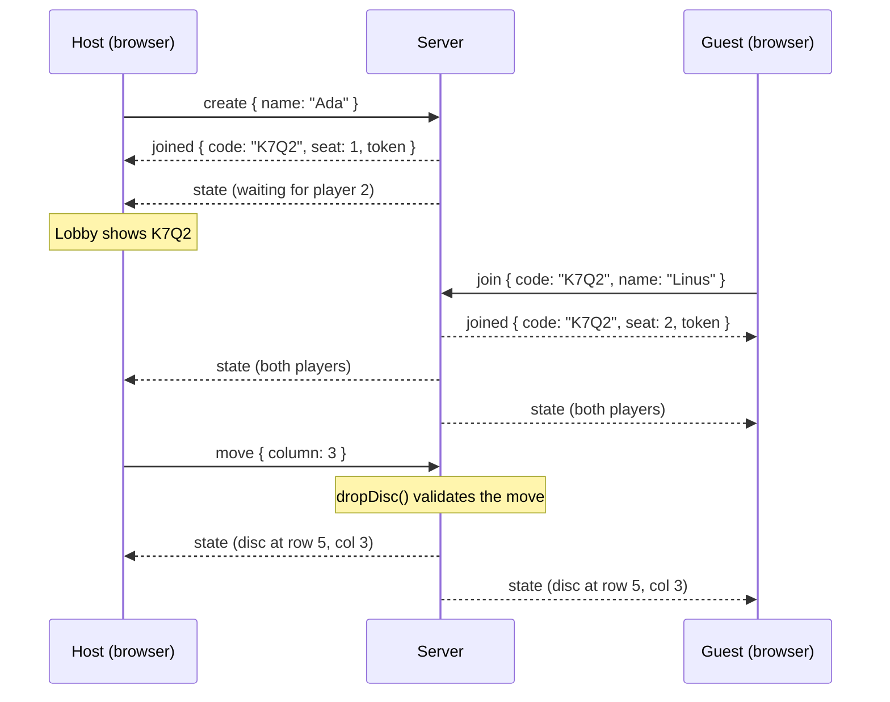

# Architecture

Four in a Row is a **client–server** app. The server is the single source of truth: clients send what the player *wants* to do, the server decides whether it's allowed, and then sends the resulting state to both players.



## Server

The server has three layers. Each one only knows about the layer below it.

### `game.js`: the rules
Pure game logic with no networking. The board is `board[row][col]`, where row 0 is the top row.

- `dropDisc(game, player, column)` checks the turn and the column, finds the lowest empty row, places the disc, and then checks for a win or a draw. It returns `{ ok, row }` or `{ ok: false, error }`.
- `findWinningLine(board, row, col)` only checks the four lines (horizontal, vertical, and both diagonals) that pass through the disc just placed, because nothing else on the board can have changed. For each direction it walks outward both ways and counts matching discs.

### `rooms.js`: the `RoomManager`
Keeps track of every room and every connected player.

```
rooms:   Map<code, room>
members: Map<connection, { room, seat }>

room = {
  code, round, scores, nextStarter, rematchVotes,
  game,                       // from game.js
  players: [seat1, seat2],    // seat = { name, token, conn }
}
```

The `RoomManager` never touches a socket. A "connection" is any object with a `send(message)` method. In production that's a thin wrapper around a WebSocket, and in the tests it's a `FakeConn` that just records messages. This is what makes the multiplayer logic testable without starting a server.

Key decisions:

- **Room codes** use a 31-character alphabet with no look-alike characters. Four characters give about 920,000 combinations, and the code generator retries on the rare collision.
- **Reconnection tokens.** When a player takes a seat, they get a random secret token. If their connection drops, the seat is kept (with `conn` set to `null`) and they can reclaim it by sending the token back. Tokens are never included in the shared state, so the opponent can't steal a seat.
- **Leaving vs. disconnecting.** Clicking "Leave game" closes the room for both players. A dropped connection only marks the seat as offline, and a room where nobody is connected is deleted after two minutes.
- **The snapshot** is the public view of a room. It's the only data ever sent to clients, and it deliberately leaves out tokens and connections.

### `index.js`: the transport
Serves the `public/` folder over HTTP and runs a WebSocket server on the same port at `/ws`. It parses each incoming JSON message and routes it to the matching `RoomManager` method with a `switch` statement. A heartbeat pings every client every 30 seconds and drops those that stop answering. Without this, a player who closes their laptop could look connected for a long time.

## Message protocol

All messages are JSON objects with a `type` field.

### Client → server

| Type | Fields | Meaning |
| --- | --- | --- |
| `create` | `name` | Host a new game |
| `join` | `code`, `name` | Join a game by its code |
| `rejoin` | `code`, `token` | Reclaim a seat after reconnecting |
| `move` | `column` (0 to 6) | Drop a disc |
| `rematch` | | Vote to play another round |
| `leave` | | Leave and close the room |

### Server → client

| Type | Fields | Meaning |
| --- | --- | --- |
| `joined` | `code`, `seat`, `token` | You have a seat; store the token |
| `state` | `state` (snapshot) | The full room state after any change |
| `error` | `message` | Your last action was rejected, with a human-readable reason |
| `closed` | `message` | The room was closed |

The server always sends the **whole** snapshot rather than just what changed. The state is tiny (a 6×7 grid plus a few fields), so this keeps clients simple and means a reconnecting client is up to date after a single message.

### Example: hosting, joining and a move



## Client

The client uses plain JavaScript modules, so there's no build step. It follows a simple **state → render** pattern, similar in spirit to React:

1. A single `state` object holds `{ code, seat, game }`.
2. Every server message updates `state` and then calls `render()`.
3. `render()` works out which screen to show from the state (no room means home, one player means lobby, two players means game) and updates the DOM to match.

### `connection.js`
Wraps the browser `WebSocket`. If the connection drops, it reconnects with exponential backoff (0.5s, 1s, 2s, up to 8s). Messages sent while offline are queued and delivered once the connection is back. When a new connection opens, `main.js` sends `rejoin` with the token stored in `sessionStorage`.

`sessionStorage` is per tab, which is why you can test the game with two tabs in the same browser.

### `board.js`
Builds the board once: 7 `<button>` columns, each containing 6 slots. After that, `update()` only changes attributes and classes. That matters for animation: because elements are reused, only the newest disc gets the `drop` class. The client knows a disc is new when the server's `moves` counter went up by exactly one since the last render.

The drop animation is pure CSS. Each slot gets a `--fall` custom property (how many rows the disc falls), and the keyframes use it to start the disc above the board, so lower rows fall farther and take slightly longer.

Columns are real buttons, so keyboard navigation, focus rings and screen reader labels work without extra code.

## Design decisions and trade-offs

| Decision | Why | Trade-off |
| --- | --- | --- |
| Authoritative server | Prevents cheating; one source of truth | Every move needs a round trip (negligible for a turn-based game) |
| Raw `ws` instead of Socket.IO | Shows how rooms and reconnection actually work; fewer dependencies | Had to write reconnection and heartbeats by hand |
| Send full snapshots | Simple clients, trivial reconnection | Slightly more data per message (still under 1 KB) |
| Rooms kept in memory | No database to set up; easy to run | Rooms are lost if the server restarts, and it can't scale past one server instance |
| No front-end framework | Zero build step; `npm start` is all you need | Manual DOM updates instead of components |

## Scaling further

In-memory rooms mean everything runs on one server process. To run several instances behind a load balancer, you'd move room state into a shared store such as Redis and use its publish/subscribe feature so that a move received by one instance reaches a player connected to another.
